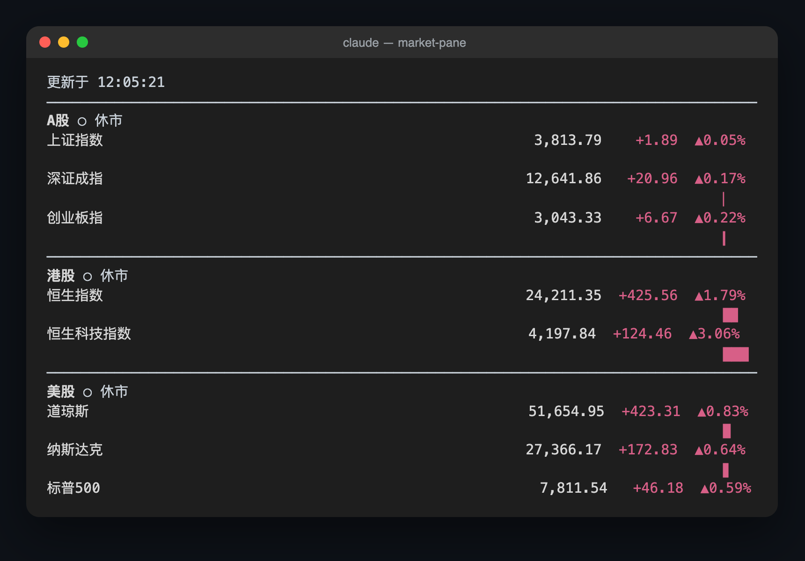
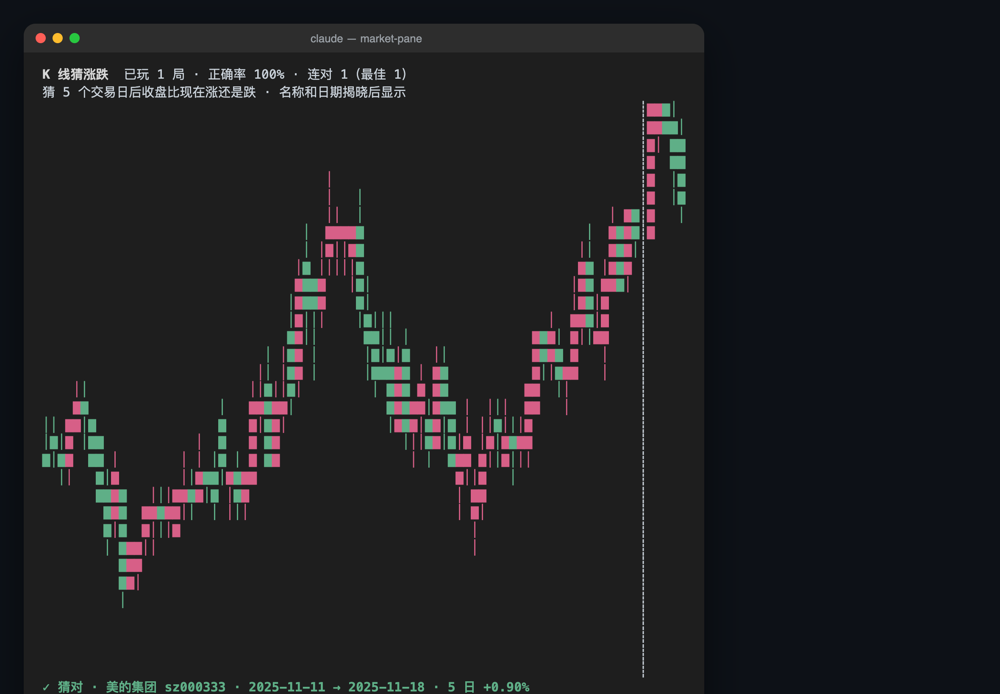

<div align="center">
  
  <h1>cc-moyu-kit</h1>
  <p><strong>A slack-off toolkit (摸鱼套件) for Claude Code. First up: <code>market-pane</code>.</strong></p>
  <p><strong>Watch A-share, Hong Kong and US markets from a side pane inside Claude Code.</strong></p>
  <p><em>Claude Mods built on Claude Code's plugin hooks. No API key, no extra window, and the pane never takes your input focus.</em></p>

  <p>
    <a href="https://github.com/androidZzT/cc-moyu-kit/stargazers"></a>
    
    
    
    
  </p>

  <p>
    <a href="#-why">Why?</a> &bull;
    <a href="#-features">Features</a> &bull;
    <a href="#-quick-start">Quick Start</a> &bull;
    <a href="#-commands">Commands</a> &bull;
    <a href="#-refresh--data-sources">Data</a> &bull;
    <a href="#-development">Development</a> &bull;
    English | <a href="README_CN.md">简体中文</a>
  </p>
</div>

---

## 🤔 Why?

A long agent turn leaves you waiting. Switching to a broker app or a browser tab to check the market pulls you out of the terminal, and it's easy to miss the moment Claude needs you again.

Claude Code 2.1.287 added **Claude Mods**: plugins can now open their own panes, register commands and fetch data through the host. `market-pane` uses that to dock a market board on the right side of the transcript. You check the market with a glance, and your prompt keeps the focus.

> cc-moyu-kit is a community project, not affiliated with Anthropic. Quotes are for reference only and are not investment advice.

---

## 🚀 Features

### 📈 Indices across three markets
> A-shares (SSE Composite, SZSE Component, ChiNext), Hong Kong (Hang Seng, Hang Seng Tech) and US (Dow Jones, Nasdaq, S&P 500), grouped by market with an open/closed light for each.

### ⭐ Watchlist
> Up to 20 symbols across A-shares, HK and US. Kept across sessions in the plugin store.

### 〰️ Intraday trend line
> Each symbol gets a second row with today's sparkline, scaled to its own high and low, plus a bar sized by the percent change (1 cell = 1%, 1/8-cell precision, full at ±4%).

### 🟥 Watched boards
> Five A-share boards: semiconductors (chip concept), AI, robotics, brokers and innovative drugs. Each shows its change for the day plus its top 3 gaining and top 3 losing stocks (ST names left out). Edit `mods/market-pane/hooks/boards.ts` to watch other boards.

### ⚡ Tick highlight
> A price that moved since the last refresh is shown in reverse video for one refresh cycle.

### 🔕 Low interruption
> No focus stealing, no dialogs, no sounds. When a fetch fails the pane keeps the last data and marks it stale.

### 🕹️ K-line guessing game for closed markets
> `/market play` turns the pane into a game: a random stretch of real daily candles from an A-share or HK name, with the name and dates hidden. Guess whether the close 5 trading days later is higher or lower, then watch the hidden candles appear one by one along with the stock, the dates and the 5-day change. Score, accuracy and streaks are kept across sessions.

<p align="center">
  
</p>

### 🎨 Readable without color
> Red for up and green for down (CN convention), with ▲/▼ as well, so direction still reads on terminals without color. Prices use thousands separators, and all three number columns are right-aligned.

---

## ⚡ Quick Start

In a Claude Code terminal session, type:

```
/plugin install market-pane --marketplace androidZzT/cc-moyu-kit
```

Answer `y` to add the marketplace, then press Enter to install at user scope. The mod is active right away, no restart needed.

To run from a clone instead (for development):

```bash
git clone https://github.com/androidZzT/cc-moyu-kit.git
claude --plugin-dir ./cc-moyu-kit/mods/market-pane
```

At 144 columns or wider, the pane opens on the right once the session starts. In a narrower terminal Claude Code doesn't place it automatically; run `/market` to open it.

---

## ⌨️ Commands

| Command | What it does |
| --- | --- |
| `/market` | Toggle the pane |
| `/market add <code> [name]` | Add to the watchlist; adding an existing code renames it |
| `/market remove <code>` | Remove from the watchlist |
| `/market list` | List the watchlist |
| `/market play` | Switch between quotes and the K-line guessing game |

In the game, click the pane once so it takes the keys: `↑`/`k` guess up, `↓`/`j` guess down, `Enter`/`n` next round, `q` back to quotes, `Esc` hands the keyboard back to the prompt. The buttons work with the mouse too. While all three markets are closed, a dim line under the boards points to `/market play`.

| Market | Code format | Example |
| --- | --- | --- |
| A-shares | `sh` / `sz` / `bj` + 6 digits | `sh600519`, `sz000001` |
| Hong Kong | `hk` + 5 digits | `hk00700` |
| US | `us` + ticker | `usAAPL`, `usBRK.B` |

The quote API returns names in GBK, which the mod can't decode, so watchlist rows show the name you give (or the code if you give none).

---

## 🔄 Refresh & Data Sources

| Data | Market open | Market closed |
| --- | --- | --- |
| Quotes and watched boards (open if any market is open) | every 10 s | every 5 min |
| A-share / HK intraday trend | every 60 s | every 30 min |
| Board top gainers / losers (A-share hours) | every 60 s | every 30 min |

- Nothing is requested while the pane is closed.
- The game fetches one symbol's daily candles per round (320 days, forward-adjusted), only when a round is dealt.
- US intraday data isn't available from the API, so the US trend line is sampled from quote refreshes while the pane is open.
- Trading hours are judged in Beijing time, with US daylight saving handled. Public holidays are not.

All data comes from Tencent Finance's public endpoints (no key). They are unofficial and come with no availability guarantee; when one changes or rate-limits, that part of the pane stays on its last data.

---

## 🎬 video-player

Play a local video in a side pane while an agent works: the picture in the pane, the sound through your speakers.

```
/plugin install video-player --marketplace androidZzT/cc-moyu-kit
```

| Command | What it does |
| --- | --- |
| `/video <absolute path> [fps]` | Play the file in the pane; fps 1–60, default 15 |
| `/video pause` / `/video resume` | Pause on the current frame / carry on from there |
| `/video seek <pos>` | Jump to `05:30` or `330` (seconds), or by `+10` / `-10` |
| `/video stop` | Stop the picture and the sound, remove the temporary frames, close the pane |

- Needs ffmpeg and ffprobe (`brew install ffmpeg`, which brings ffplay for the sound) and a terminal that shows images, such as kitty or Ghostty
- Under the picture: a progress bar as wide as the pane (click a cell to jump there) and ⏸/▶, « 10s, 10s » buttons with hotkeys `p`, `h`, `l` once the pane has focus, followed by `01:05 / 14:48 · 15 fps`
- Frames are raw RGB, so the terminal draws them without decoding. ffmpeg runs only about 2 seconds ahead and frames already shown are deleted, so the temp folder stays around 30 MB at 15 fps whatever the length
- No streams, subtitles, speed or volume control yet. Tested on macOS with Ghostty

Details in [`mods/video-player/README.md`](mods/video-player/README.md).

---

## 🛠️ Development

```bash
cd mods/market-pane
claude plugin validate .
claude plugin test .
npx -p typescript tsc -p .   # load once with --plugin-dir first to generate .claude-plugin/types
```

Every call that touches `$` (the engine) lives in `hooks/register.tsx`; parsing, trading hours, rendering and watchlist logic are pure modules with their own tests. See [`mods/market-pane/README.md`](mods/market-pane/README.md) for the file map. `mods/video-player` follows the same layout.

Specs and change history are kept with [OpenSpec](openspec/).

---

## 📄 License

[MIT](LICENSE)
